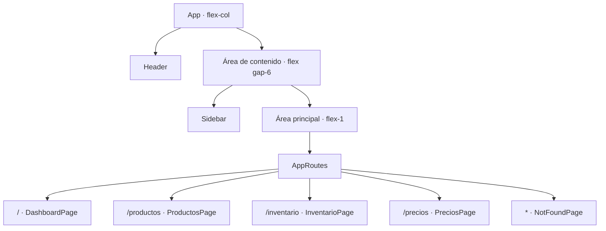

# Diseño y arquitectura del frontend — ProGear MX

**Estado revisado:** 14 de octubre de 2026

**Alcance:** estructura visual y navegación inicial en `frontend/`.

Este documento registra lo que está presente en el código actual y separa las
decisiones implementadas de las interacciones que aún están planeadas. El
frontend todavía no se conecta con la API.

## Composición de la aplicación

`App.tsx` usa un contenedor principal en columna. El `Header` queda arriba; un
segundo contenedor en fila agrupa la `Sidebar` y el área flexible que contiene
`AppRoutes`.

El contenedor que agrupa `Sidebar` y `AppRoutes` es importante: al ser
elementos hermanos dentro de la misma fila aparecen uno al lado del otro. Si
las rutas quedan fuera, se convierten en otro bloque de la columna principal.

## Componentes y páginas actuales

| Pieza | Responsabilidad y estado actual |
|---|---|
| `App` | Compone `Header`, `Sidebar` y el área de rutas. Usa `flex-col` para el layout exterior y `flex gap-6` para la fila interior. |
| `Header` | Muestra el nombre ProGear MX en la parte superior. Tiene un marcador y espacio reservado para un control; aún no alterna la Sidebar. |
| `Sidebar` | Muestra un placeholder de logo, el nombre y lema de la marca, y enlaces a Productos, Inventario y Precios. |
| `DashboardPage` | Ruta `/`; muestra “ProGear MX”, “Panel Principal” y un mensaje de bienvenida. |
| `ProductosPage` | Ruta `/productos`; actualmente muestra “Gestión de productos”. |
| `InventarioPage` | Ruta `/inventario`; actualmente muestra “Gestión de inventario”. |
| `PreciosPage` | Ruta `/precios`; actualmente muestra “Historial de precios”. |
| `NotFoundPage` | Ruta comodín `*`; muestra el estado 404 y un mensaje de página no encontrada. |

Las páginas de módulos son encabezados iniciales. No se documentan formularios,
listados ni operaciones funcionales que todavía no estén en el código.

## Rutas

| Ruta | Página | Enlace en `Sidebar` |
|---|---|---|
| `/` | `DashboardPage` | No hay enlace de dashboard en la Sidebar actual. |
| `/productos` | `ProductosPage` | Productos |
| `/inventario` | `InventarioPage` | Inventario |
| `/precios` | `PreciosPage` | Precios |
| Cualquier otra ruta | `NotFoundPage` | No aplica |

## Navegación activa

`Sidebar` utiliza `NavLink` de React Router y recibe `isActive` para elegir las
clases. El enlace activo usa fondo `bg-primary` y texto blanco. Los enlaces
inactivos usan fondo transparente y `text-secondary`, y muestran
`hover:bg-white/10` al pasar el cursor. Esta lógica está en el código; la
apariencia de cada estado no se volvió a comprobar en el navegador durante
esta actualización documental. Como no existe un enlace para `/`, no hay un
enlace activo en la Sidebar cuando se muestra el dashboard.

## Tema visual de Tailwind

`frontend/src/index.css` importa Rajdhani e Inter antes de Tailwind y declara
los siguientes tokens dentro de `@theme`:

| Token | Valor actual en el archivo | Uso declarado |
|---|---|---|
| `--color-primary` | `#1677E8` | Acento azul y enlace activo. |
| `--color-secondary` | `#A7ADB7` | Texto secundario y borde del placeholder de logo. |
| `--color-accent` | `#E32636` | Acento rojo. |
| `--color-surface` | `#171A20` | Superficie de Header y Sidebar. |
| `--color-background` | `#0B0D10` | Fondo general. |
| `--color-foreground` | `#F4F5F7` | Texto general. |
| `--font-display` | Rajdhani | Títulos y encabezados. |
| `--font-sans` | Inter | Texto general. |

La dirección definida es oscura, industrial y de carreras, con azul y rojo
como acentos. El código declara ambas fuentes, pero su carga efectiva no se ha
comprobado. También queda una diferencia documental: el resumen de la sesión
del 12 de octubre menciona `#2589FF`, mientras que el valor actual en
`index.css` es `#1677E8`.

## Decisiones pendientes

- Definir cómo se activa el control de Sidebar y si el ocultamiento dependerá
  del ancho de pantalla. El disparador, el breakpoint y el comportamiento al
  navegar aún no están especificados ni implementados.
- Completar el contenido funcional de las páginas.
- Conectar el frontend con la API.
- Comprobar en navegador los estados de navegación y la carga de las fuentes.
- Conciliar el valor documentado anteriormente para `--color-primary`.

Los requerimientos y estados se mantienen en
[`docs/requirements/frontend-requirements.md`](../requirements/frontend-requirements.md).
