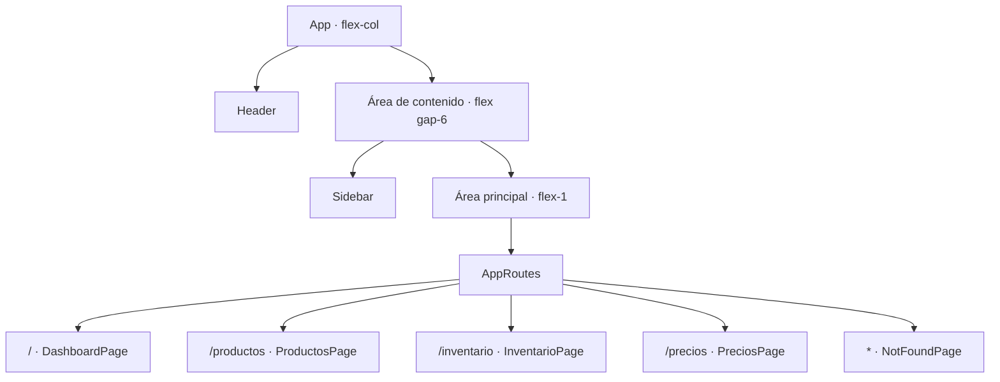

# Diseño y arquitectura del frontend — ProGear MX

**Estado revisado:** 15 de octubre de 2026

**Alcance:** estructura visual y navegación inicial en `frontend/`.

Este documento registra lo que está presente en el código actual y separa las
decisiones implementadas de las interacciones que aún están planeadas. El
frontend todavía no se conecta con la API.

## Composición de la aplicación

`App.tsx` usa un contenedor principal en columna. El `Header` queda arriba; un
segundo contenedor en fila agrupa la `Sidebar` y el área flexible que contiene
`AppRoutes`.



El contenedor que agrupa `Sidebar` y `AppRoutes` es importante: al ser
elementos hermanos dentro de la misma fila aparecen uno al lado del otro. Si
las rutas quedan fuera, se convierten en otro bloque de la columna principal.

## Componentes y páginas actuales

| Pieza | Responsabilidad y estado actual |
|---|---|
| `App` | Compone `Header`, `Sidebar` y el área de rutas. Usa `flex-col` para el layout exterior y `flex gap-6` para la fila interior. |
| `Header` | Muestra el nombre ProGear MX en la parte superior. Tiene un marcador y espacio reservado para un control; aún no alterna la Sidebar. |
| `Sidebar` | Muestra un placeholder de logo, el nombre y lema de la marca, y enlaces a Productos, Inventario y Precios. |
| `DashboardPage` | Ruta `/`; muestra “ProGear MX”, “Panel Principal” y un mensaje de bienvenida. |
| `ProductosPage` | Ruta `/productos`; actualmente muestra “Gestión de productos”. |
| `InventarioPage` | Ruta `/inventario`; actualmente muestra “Gestión de inventario”. |
| `PreciosPage` | Ruta `/precios`; actualmente muestra “Historial de precios”. |
| `NotFoundPage` | Ruta comodín `*`; muestra el estado 404 y un mensaje de página no encontrada. |

Las páginas de módulos son encabezados iniciales. No se documentan formularios,
listados ni operaciones funcionales que todavía no estén en el código.

## Rutas

| Ruta | Página | Enlace en `Sidebar` |
|---|---|---|
| `/` | `DashboardPage` | No hay enlace de dashboard en la Sidebar actual. |
| `/productos` | `ProductosPage` | Productos |
| `/inventario` | `InventarioPage` | Inventario |
| `/precios` | `PreciosPage` | Precios |
| Cualquier otra ruta | `NotFoundPage` | No aplica |

## Navegación activa

`Sidebar` utiliza `NavLink` de React Router y recibe `isActive` para elegir las
clases. El enlace activo usa fondo `bg-primary` y texto blanco. Los enlaces
inactivos usan fondo transparente y `text-secondary`, y muestran
`hover:bg-white/10` al pasar el cursor. Esta lógica está en el código; la
apariencia de cada estado no se volvió a comprobar en el navegador durante
esta actualización documental. Como no existe un enlace para `/`, no hay un
enlace activo en la Sidebar cuando se muestra el dashboard.

## Tema visual de Tailwind

`frontend/src/index.css` importa Rajdhani e Inter antes de Tailwind y declara
los siguientes tokens dentro de `@theme`:

| Token | Valor actual en el archivo | Uso declarado |
|---|---|---|
| `--color-primary` | `#1677E8` | Acento azul y enlace activo. |
| `--color-secondary` | `#A7ADB7` | Texto secundario y borde del placeholder de logo. |
| `--color-accent` | `#E32636` | Acento rojo. |
| `--color-surface` | `#171A20` | Superficie de Header y Sidebar. |
| `--color-background` | `#0B0D10` | Fondo general. |
| `--color-foreground` | `#F4F5F7` | Texto general. |
| `--font-display` | Rajdhani | Títulos y encabezados. |
| `--font-sans` | Inter | Texto general. |

La dirección definida es oscura, industrial y de carreras, con azul y rojo
como acentos. El código declara ambas fuentes, pero su carga efectiva no se ha
comprobado. También queda una diferencia documental: el resumen de la sesión
del 12 de octubre menciona `#2589FF`, mientras que el valor actual en
`index.css` es `#1677E8`.

## Decisiones pendientes

- Definir cómo se activa el control de Sidebar y si el ocultamiento dependerá
  del ancho de pantalla. El disparador, el breakpoint y el comportamiento al
  navegar aún no están especificados ni implementados.
- Completar el contenido funcional de las páginas.
- Conectar el frontend con la API.
- Comprobar en navegador los estados de navegación y la carga de las fuentes.
- Conciliar el valor documentado anteriormente para `--color-primary`..


## 1. Propósito

El frontend de ProGear MX proporciona una interfaz web para consultar y
gestionar las funcionalidades de la tienda.

El diseño prioriza la claridad, la consistencia visual, la reutilización de
componentes y la facilidad de navegación.

La inspiración tecnológica de la identidad visual no debe distraer del
objetivo principal: facilitar la gestión de productos, inventario y precios.

## 2. Tecnologías

- React: construcción de interfaces mediante componentes.
- TypeScript: definición de tipos para las propiedades y estructuras del frontend.
- Vite: entorno de desarrollo y construcción.
- Tailwind CSS: estilos mediante clases de utilidad.
- React Router: navegación entre páginas.
- Lucide React: iconografía.

## 3. Estructura conceptual

```text
App
├── Header
├── Sidebar
└── AppRoutes
    ├── DashboardPage
    │   └── KpiCard
    ├── ProductosPage
    ├── InventarioPage
    ├── PreciosPage
    └── NotFoundPage
```

`App` organiza la estructura general de la aplicación.

`Header` presenta el encabezado superior y el botón Menú.

`Sidebar` contiene los enlaces de navegación y señala visualmente la ruta activa.

`AppRoutes` determina qué página se representa según la ruta actual.

`DashboardPage` organiza las tarjetas KPI y define su orden, identificadores,
títulos, valores e iconos.

`KpiCard` representa visualmente una KPI mediante un componente reutilizable.

Las páginas de Productos, Inventario y Precios cuentan con rutas, pero sus
interfaces funcionales todavía están pendientes.

## 4. Identidad visual

### Paleta de colores

| Token | Valor | Uso previsto |
|---|---|---|
| Primary | `#2589FF` | Títulos destacados, valores e indicadores principales |
| Secondary | `#A7ADB7` | Texto secundario y etiquetas auxiliares |
| Accent | `#E32636` | Alertas y situaciones que requieren atención |
| Surface | `#171A20` | Tarjetas, Sidebar y paneles |
| Background | `#0B0D10` | Fondo general |
| Foreground | `#F4F5F7` | Texto principal |

Los colores están configurados en `frontend/src/index.css` mediante el tema
de Tailwind CSS.

### Tipografía

- `font-display`: Rajdhani, para títulos, marca y valores destacados.
- `font-sans`: Inter, para textos generales, descripciones y navegación.

La elección de la tipografía debe reforzar la jerarquía visual sin afectar
la legibilidad.

### Principios visuales

- Interfaz oscura con contraste suficiente.
- Azul reservado para elementos visualmente importantes.
- Gris plateado para información secundaria.
- Espaciado consistente.
- Componentes reutilizables.
- Uso de iconos para facilitar la identificación de las categorías.
- Evitar elementos decorativos que dificulten la gestión de la tienda.

## 5. Dashboard

La página inicial utiliza el encabezado:

- Etiqueta: `PANEL PRINCIPAL / INVENTARIO`
- Título: `Resumen General`
- Descripción: `Consulta el estado de tus productos y las existencias de tu tienda.`

Debajo se muestran cuatro tarjetas KPI.

| Orden | Identificador | Indicador | Valor ilustrativo |
|---|---|---|---:|
| 1 | KPI / 01 | Productos registrados | 120 |
| 2 | KPI / 02 | Existencias físicas | 120 |
| 3 | KPI / 03 | Reservado | 20 |
| 4 | KPI / 04 | Disponible | 100 |

Los valores son ilustrativos y no proceden de la API.

La disponibilidad representa la existencia física menos las unidades
reservadas:

`Disponible = Existencia - Reservado`

El indicador de productos registrados representa la cantidad de productos
distintos, no la cantidad total de unidades almacenadas.

## 6. Componente KpiCard

Archivo: `frontend/src/components/dashboard/KpiCard.tsx`

El componente recibe las siguientes propiedades:

```tsx
type KpiCardProps = {
    id: string;
    titulo: string;
    valor: number;
    icono: LucideIcon;
};
```

### Responsabilidades

- Mostrar el icono recibido.
- Presentar el título de la KPI.
- Mostrar el valor numérico.
- Mostrar el identificador técnico de la tarjeta.
- Aplicar una presentación consistente a todas las KPI.

### Decisión de diseño

El componente no decide qué KPI debe aparecer ni en qué orden.

Esas decisiones corresponden a `DashboardPage`. De esta manera, la misma
estructura visual puede utilizarse con diferentes datos e iconos.

### Estilos principales

- `rounded-2xl`: esquinas redondeadas.
- `bg-surface`: superficie de la tarjeta.
- `p-5`: espaciado interior.
- `flex flex-col`: distribución vertical.
- `gap-3`: separación entre los elementos.
- `text-primary`: color principal de los valores.
- `font-display`: tipografía de los valores y etiquetas técnicas.
- `text-5xl`: tamaño de los valores numéricos.
- `text-secondary`: color secundario de los identificadores.

Los iconos utilizan el azul de marca y un tamaño de 24 píxeles.

## 7. Navegación

La Sidebar presenta los enlaces en el siguiente orden:

1. Inicio
2. Productos
3. Inventario
4. Precios

Se utiliza `NavLink` de React Router para identificar la ruta activa y aplicar
sus estilos correspondientes.

El Header incluye un botón Menú asociado a la propiedad
`onToggleSidebar`.

El comportamiento completo de visibilidad de la Sidebar debe verificarse,
incluyendo su interacción con teclado y dispositivos táctiles.

## 8. Diseño responsivo

La cuadrícula del dashboard utiliza:

```tsx
<div className="grid grid-cols-1 gap-4 md:grid-cols-2">
```

La intención es mostrar una columna por defecto y dos columnas a partir del
punto de quiebre `md`.

Esto permite adaptar las tarjetas a pantallas estrechas y conservar una
disposición de dos columnas en pantallas medianas y grandes.

La adaptación debe comprobarse visualmente en diferentes tamaños de ventana.

## 9. Integración con el backend

La integración entre el frontend y la API REST todavía está pendiente.

Los valores de las KPI son datos ilustrativos. No deben presentarse como
información real del inventario.

La integración deberá contemplar:

- Consultas a los endpoints correspondientes.
- Manejo de estados de carga.
- Manejo de errores de red y respuestas HTTP no exitosas.
- Representación de datos vacíos.
- Uso de los valores devueltos por la API.
- Consistencia con las reglas de negocio del backend.

## 10. Pendientes

- Completar y verificar el comportamiento de la Sidebar.
- Conectar las KPI a datos reales.
- Implementar las interfaces funcionales de Productos, Inventario y Precios.
- Incorporar estados de carga, error y ausencia de datos.
- Comprobar el diseño responsivo.
- Revisar accesibilidad y navegación por teclado.
- Añadir pruebas para los componentes y los flujos principales.

## 11. Principio de diseño

El frontend debe facilitar las operaciones de la tienda.

Las decisiones visuales deben favorecer la legibilidad, la identificación
rápida de la información y la consistencia entre pantallas. La estética
tecnológica complementa la experiencia, pero no sustituye la funcionalidad.

Los requerimientos y estados se mantienen en
[`docs/requirements/frontend-requirements.md`](../requirements/frontend-requirements.md).
